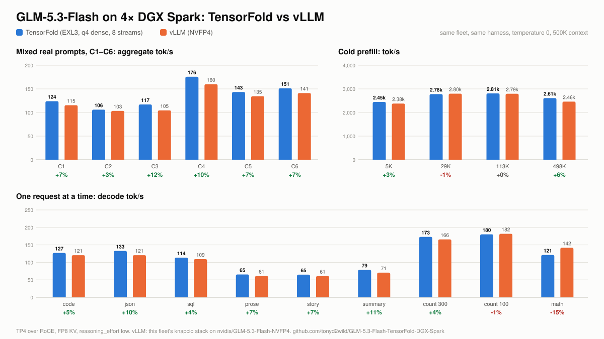

# GLM-5.3-Flash on TensorFold, TP4 and TP2 on DGX Spark (EXL3)

> **Special credit:** [tonyd2wild](https://github.com/tonyd2wild) (the Spark serving recipe this fleet runs),
> [ashhart/TensorFold](https://github.com/ashhart/TensorFold) (the engine) and Brandon M. Music's EXL3 checkpoint.
> Everyone whose work this builds on: [CREDITS.md](CREDITS.md).

GLM-5.3-Flash served by TensorFold across four DGX Sparks (or two): eight requests at once with a 500K window each,
vision, FP8 KV cache, RoCE all-gathers. Reddie is the head node and serves the weights to the other Sparks over NFS.
On this fleet and the same harness it is ahead of our vLLM stack at every concurrency level.

<picture>
  <source media="(prefers-color-scheme: dark)" srcset="runs/2026-10-11-exl3-q4-tp4/charts/tf-vs-vllm-dark.svg">
  
</picture>

## Lanes (2026-10-12)

| lane | Sparks | streams | max context | KV pool (FP8, shared) | launch |
|---|---|---|---|---|---|
| **TP4, the default** (`glm-5.3-flash` on `:8000`) | Reddie, Spark4, Asusi, Bluey | 8 | 500,000 tokens a request | 5,285,888 tokens: all 8 streams hold 500K at once, 1.29M left for kept prompts | `deploy/serve_exl3.sh` |
| TP2 | Reddie, Spark4 | 4 | 500,000 tokens a request | 2,033,664 tokens: all 4 streams hold 500K at once | `TP=2 deploy/serve_exl3.sh` |

Both lanes serve the same thing:

| | |
|---|---|
| engine | [`engine-multi/`](engine-multi/): TensorFold v0.6.0 + MiaAI-Lab's GLM patches (Apache-2.0) + our changes |
| weights | [`brandonmusic/GLM-5.3-Flash-tr3-4bpw`](https://huggingface.co/brandonmusic/GLM-5.3-Flash-tr3-4bpw) (164 GiB), over NFS from Reddie |
| formats | routed experts EXL3 4-bit (`mcg` trellis); attention, indexer, shared and dense MLP as 4-bit groups of 64 quantized at load (`TF_GLM_DENSE=q4`); head FP8; `kv_b`, embedding, vision tower BF16 |
| vision | on: GLM's vision tower on rank 0 |
| thinking | `reasoning_effort: low` by default |
| drafts | MTP, DFlash2 (`incoai/GLM-5.3-Flash-DFlash2`) and copy drafts |
| load | about 155 s |

`deploy/serve_exl3.sh serve | stop | status | logs [rank]` wraps [`deploy/tf_tp4.sh`](deploy/tf_tp4.sh), which sets the
per-lane streams, prompt settings, kept-state pool and memory reserve from `TP`. `DENSE=fp8` holds the non-expert
matrices as FP8 instead (about 10 % slower; see How we got here).

## Results: TP4 lane against vLLM (2026-10-11)

Speed-night harness ([`bench/bench_tp2_night.py`](bench/bench_tp2_night.py)), temperature 0, `reasoning_effort: low`,
on a private port so fleet traffic could not take a stream; no failures, no preemptions. Full tables:
[`runs/2026-10-11-exl3-q4-tp4/TABLES.md`](runs/2026-10-11-exl3-q4-tp4/TABLES.md).

| | TensorFold TP4 | vLLM knapcio stack | difference |
|---|---|---|---|
| mixed real prompts, C1–C6 (aggregate tok/s, median of 3) | 124 / 106 / 117 / 176 / 143 / 151 | 115 / 103 / 105 / 160 / 135 / 141 | +7 / +3 / +12 / +10 / +7 / +7 % |
| same, peak of 3 | 124 / 158 / 175 / 177 / 189 / 166 | 117 / 153 / 156 / 162 / 176 / 147 | ahead at every level |
| cold prefill, 6K / 30K / 114K / 499K tokens | 2,447 / 2,780 / 2,808 / 2,611 tok/s | 2,378 / 2,798 / 2,794 / 2,462 | +3 / −1 / +0 / +6 % |
| 500K window | 498,635-token prompt in 191 s | 202 s | |
| one stream: code / json / sql / prose / summary | 127 / 133 / 114 / 65 / 79 tok/s | 121 / 121 / 109 / 61 / 71 | +5 / +10 / +4 / +7 / +11 % |
| one stream: count to 300 / count to 100 / math | 173 / 180 / 121 tok/s | 166 / 182 / 142 | +4 / −1 / −15 % |
| one stream: tool call (end to end) | 93 tok/s | 68 | +37 % |
| C1–C6 by prompt type, aggregate at C6 | count to 100 439, json 301, YAML 288, math 271, code 256, prose 152 tok/s | | |
| time to first token at C6, short prompts (p90) | 0.3 to 0.8 s | | |
| vision / quality check (10 prompts, 3 languages) | pass / 10 of 10 | | |

The vLLM column is this fleet's knapcio stack on `nvidia/GLM-5.3-Flash-NVFP4` (2026-09-29, same harness, 500K, effort
low). Math is the one prompt where vLLM's drafting still leads by a margin.

## Results: TP2 lane (2026-10-12)

Two Sparks, the same harness and settings. Full tables:
[`runs/2026-10-12-exl3-q4-tp2/TABLES.md`](runs/2026-10-12-exl3-q4-tp2/TABLES.md).

| | TP2 lane | TP4 lane |
|---|---|---|
| one stream: count to 100 / code / json / math / prose | 110 / 82 / 84 / 79 / 44 tok/s | 180 / 127 / 133 / 121 / 65 |
| by prompt type at C4 (its 4 streams, aggregate) | count to 100 239, YAML 164, json 160, math 147, code 140, prose 82 tok/s | 348 / 223 / 266 / 226 / 218 / 131 |
| mixed real prompts, C1–C4 (median of 3) | 77 / 68 / 73 / 108 tok/s | 124 / 106 / 117 / 176 |
| cold prefill, 6K / 30K / 114K / 499K tokens | 1,721 / 1,827 / 1,781 / 1,467 tok/s | 2,447 / 2,780 / 2,808 / 2,611 |
| 500K window | 498,633-token prompt in 340 s | 191 s |
| vision / quality check | pass / 10 of 10 | pass / 10 of 10 |

At C5 and C6 the TP2 lane's fifth and sixth requests wait for a stream (first token 18–21 s).

## How we got here (2026-10-11, same harness)

| build | count to 100 | code | json | prose | mixed C6 | prefill 114K | 500K prompt |
|---|---|---|---|---|---|---|---|
| first build: `engine/`, NVFP4 pack, one request at a time | 110.6 | 80.6 | 81.4 | 46.8 | 61.1 | 887 | 646 s |
| `engine-multi/`, NVFP4 pack, 8 streams | 149.9 | 109.0 | 113.0 | 54.4 | 134.4 | 2,038 | 259 s |
| EXL3, FP8 dense | 163.7 | 101.4 | 119.5 | 54.1 | 141.1 | 2,561 | 208 s |
| **EXL3, q4 dense (default)** | **180.2** | **127.0** | **132.7** | **65.4** | **151.2** | **2,808** | **191 s** |
| first build → default | +63 % | +58 % | +63 % | +40 % | 2.5× | 3.2× | 3.4× faster |

Every run's tables, raw results and charts: [`runs/`](runs/) (`2026-10-11-baseline`, `2026-10-11-multi-engine`,
`2026-10-11-exl3`, `2026-10-11-exl3-q4-tp4`, `2026-10-12-exl3-q4-tp2`).

- **EXL3 over NVFP4 on the same engine:** a one-row verify step of 21.1 ms instead of 25.1 ms. ashhart notes the EXL3
  path is the optimised one in TensorFold; the NVFP4 path is not tuned yet.
- **q4 over FP8 dense layers:** 5 to 51 % more decode on one stream (median 12 %), prefill up 9 to 10 %, and the same 10 of 10 on the
  quality check, including the short French, Spanish and Chinese prompts where MiaAI-Lab saw q4 lose the end of turn.

## Approach

1. **The engine.** `engine-multi/` is a squashed subtree of TensorFold v0.6.0 with MiaAI-Lab's 106 GLM patches
   (concurrent requests, TP-N, FP8 KV, RoCE all-gathers, split prefill, copy drafts, vision, 4-bit dense layers), kept
   as published with their notices.
2. **The checkpoint.** EXL3 is read by TensorFold's GLM EXL3 expert kernels; the BF16 non-expert matrices are quantized
   at load. For the NVFP4 comparison we added a ModelOpt reader and splitter: NVFP4 routed experts on the engine's grouped
   NVFP4 kernels, MXFP8 and FP8-block projections on its 8-bit kernels.
3. **Vision on any GLM template.** Templates that write the media markers themselves (`emit_image` / `emit_video`) get
   each image's mark placed before them.
4. **Lanes.** One launcher for two or four Sparks: it stops every rank before a start (no follower joins an old
   rendezvous), every rank reads the weights from the same NFS path, and the per-lane settings follow `TP`.

Each piece's origin is in [PROVENANCE.md](PROVENANCE.md).

## Layout

| path | what |
|---|---|
| `engine-multi/` | the serving engine: TensorFold v0.6.0 + MiaAI-Lab's GLM patches (Apache-2.0) + our changes |
| `engine/` | the first, one-at-a-time build: TensorFold Python line (ashhart, Apache-2.0) with our changes |
| `deploy/` | `serve_exl3.sh` (what serves, `TP=4` or `TP=2`) and `tf_tp4.sh`, the launcher (head node, NFS weights, drafts, vision, context, effort, port, lane settings) |
| `bench/` | the speed-night harness (per-type C1–C6 sweep, vision check) and `qcheck.py`, the quality check |
| `runs/` | each run's tables, raw results and charts |

## Fleet

| node | TP4 rank | TP2 rank | role |
|---|---|---|---|
| Reddie | 0 | 0 | head, HTTP, NFS server for weights and drafter |
| Spark4 | 1 | 1 | weights over NFS |
| Asusi | 2 | | weights over NFS |
| Bluey | 3 | | weights over NFS |
