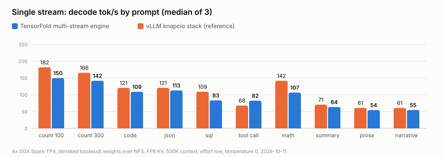
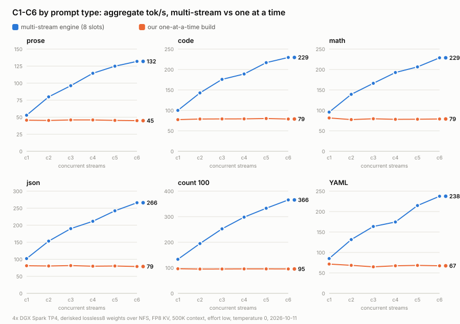
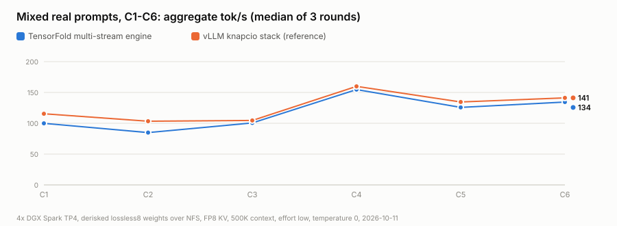
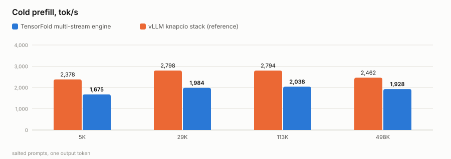

# GLM-5.3-Flash on TensorFold, TP4 on 4× DGX Spark, with our derisked weights

> **Special credit:** [tonyd2wild](https://github.com/tonyd2wild) (the 4× Spark serving recipe this fleet runs) and
> [ashhart/TensorFold](https://github.com/ashhart/TensorFold) (the engine). Full ledger: [CREDITS.md](CREDITS.md).

**Private working repo.** GLM-5.3-Flash served by the TensorFold engine at tensor-parallel 4 across our four DGX
Sparks, from our derisked weights as stored, with Reddie as the head node and the weights read over NFS from Reddie.

## Serving now (2026-10-11)

| | |
|---|---|
| endpoint | `glm-5.3-flash` on `:8000` (Reddie), the fleet's name and port |
| engine | [`engine-multi/`](engine-multi/): TensorFold v0.6.0 + MiaAI-Lab's GLM patches (Apache-2.0) + our derisked-weights port |
| layout | TP4: Reddie rank 0 (HTTP), Spark4 rank 1, Asusi rank 2, Bluey rank 3; RoCE all-gathers on the switch, NCCL for control |
| weights | `glm-quant-mix-derisked/lossless8` (198 GB) read as stored, over NFS from Reddie |
| formats | routed experts NVFP4, linear-attention projections MXFP8, MLA and shared experts FP8 (128×128 blocks): all on 8-bit / 4-bit kernels as stored |
| streams | 8 at once, one shared pool of 5,285,888 tokens, each request up to 500,000 |
| KV cache | FP8 |
| context | 500,000 tokens (a 498,635-token prompt measured: 259 s) |
| vision | on: GLM's vision tower on rank 0 |
| thinking | `reasoning_effort: low` by default |
| drafts | MTP, DFlash2 (`incoai/GLM-5.3-Flash-DFlash2`, over NFS) and copy drafts |
| load | about 160 s warm |

Launch, stop, logs: [`deploy/tf_tp4.sh`](deploy/tf_tp4.sh): `NAME=tfmia PROFILE=multi deploy/tf_tp4.sh serve | stop |
status | logs [rank]`. `PROFILE=single` (the default) starts the previous one-at-a-time build in [`engine/`](engine/).

## Baseline (2026-10-11)

Speed-night harness ([`bench/bench_tp2_night.py`](bench/bench_tp2_night.py)), temperature 0, `reasoning_effort: low`,
on a private port so fleet traffic could not take any of the 8 streams. Full tables:
[`runs/2026-10-11-multi-engine/TABLES.md`](runs/2026-10-11-multi-engine/TABLES.md); raw JSON in
[`runs/2026-10-11-multi-engine/results/`](runs/2026-10-11-multi-engine/results/).

| | TensorFold multi-stream | vLLM knapcio stack (reference) | our one-at-a-time build |
|---|---|---|---|
| single stream, count to 100 / code / json / math / prose | 149.9 / 109.0 / 113.0 / 106.6 / 54.4 tok/s | 181.7 / 120.5 / 120.5 / 141.8 / 61.0 | 110.6 / 80.6 / 81.4 / 78.2 / 46.8 |
| single stream, tool call (end to end) | 82.5 tok/s | 67.9 | 82.7 |
| code alone, C1 / C2 / C4 / C6 (aggregate) | 100 / 143 / 189 / 230 tok/s | | 77 / 79 / 79 / 79 |
| json alone, C1 / C2 / C4 / C6 (aggregate) | 102 / 153 / 212 / 266 tok/s | | |
| time to first token at C6, short prompts | 0.6 to 0.9 s (p90) | | up to 75 s (queued) |
| mixed prompts C1–C6 (median of 3) | 100 / 85 / 101 / 155 / 126 / 134 | 115 / 103 / 105 / 160 / 135 / 141 | 75 / 67 / 56 / 75 / 57 / 61 |
| cold prefill, 6K / 30K / 114K / 499K tokens | 1,675 / 1,984 / 2,038 / 1,928 tok/s | 2,378 / 2,798 / 2,794 / 2,462 | 864 / 894 / 887 / 772 |
| vision | pass (1.6 s) | | pass |

The vLLM column is this fleet's knapcio stack on `nvidia/GLM-5.3-Flash-NVFP4` (2026-09-29, same harness, 500K,
effort low): the derisked weights have the same architecture and formats.

<picture>
  <source media="(prefers-color-scheme: dark)" srcset="runs/2026-10-11-multi-engine/charts/tfm-single-vs-vllm-dark.svg">
  
</picture>

<picture>
  <source media="(prefers-color-scheme: dark)" srcset="runs/2026-10-11-multi-engine/charts/tfm-types-vs-single-dark.svg">
  
</picture>

<picture>
  <source media="(prefers-color-scheme: dark)" srcset="runs/2026-10-11-multi-engine/charts/tfm-sweep-vs-vllm-dark.svg">
  
</picture>

<picture>
  <source media="(prefers-color-scheme: dark)" srcset="runs/2026-10-11-multi-engine/charts/tfm-prefill-vs-vllm-dark.svg">
  
</picture>

### What the numbers say

- **Concurrency works.** Every prompt type scales with streams (code 100 → 230, json 102 → 266 at C1 → C6) with the
  first token under a second; the one-at-a-time build stayed flat and queued.
- **One stream is 75 to 94 % of vLLM** (tool calls 121 %). A one-row verify step is 25.1 ms (29.0 ms before).
- **Mixed prompts are near vLLM** (82 to 97 % of its median by level); the mixed rounds swing between runs: a quick
  run the same morning was ahead of vLLM at C2, C3 and C5.
- **Prefill is 70 to 78 % of vLLM**, 1.9 to 2.5× the previous build; the 500K prompt reads in 259 s (646 s before).

### Next

1. **EXL3 weights.** ashhart: the EXL3 path is the optimised one and NVFP4 is not optimised yet. The multi engine
   already reads Brandon M. Music's EXL3 GLM-5.3-Flash (`brandonmusic/GLM-5.3-Flash-tr3-4bpw`, 4-bit `mcg` routed
   experts, BF16 elsewhere) at TP4.
2. **NVFP4 checkpoint precision.** TensorFold 0.6.6 runs NVFP4 layers as FP4 × FP4 block-scaled MMA (the 27B: one
   stream 1.23×, prompts 2.3× its bf16-activation path); GLM is not wired to it, and our pack stores no activation
   input scales.

## Previous build: one request at a time

[`engine/`](engine/) is TensorFold's Python engine (`python-0.6`) with one third-party author's code removed and our
ModelOpt reader, TP4 and CUDA vision added. It serves one request at a time; its baseline (C1 count to 100 110.6
tok/s, prefill about 880 tok/s) is in [`runs/2026-10-11-baseline/`](runs/2026-10-11-baseline/TABLES.md).

## Approach

1. **The engine.** `engine-multi/` is a squashed subtree of TensorFold v0.6.0 with MiaAI-Lab's 106 GLM patches
   (concurrent requests, TP-N, FP8 KV, RoCE all-gathers, split prefill, copy drafts, vision), kept as published with
   their notices.
2. **Our checkpoint as stored.** A ModelOpt reader and splitter: NVFP4 routed experts on the engine's grouped NVFP4
   kernels, MXFP8 and FP8-block projections on its 8-bit kernels, the BF16 tensors as they are, stale duplicate
   tensors resolved by the index, the pack marker skipped.
3. **Vision on our template.** The derisked template writes the media markers itself (`emit_image` / `emit_video`);
   the engine now places each image's mark before them.
4. **Four Sparks.** The launcher stops every rank before a start, so no follower joins an old rendezvous.

Each piece's origin is in [PROVENANCE.md](PROVENANCE.md).

## Provenance policy

`engine-multi/` is built on MiaAI-Lab's Apache-2.0 GLM patches: their code is used where it helps, with its notices
kept and credit in [CREDITS.md](CREDITS.md). `engine/` leaves out one third-party author's code as described in
[PROVENANCE.md](PROVENANCE.md). Other open-source code is taken with credit; every piece's origin is logged there.

## Layout

| path | what |
|---|---|
| `engine-multi/` | the serving engine: TensorFold v0.6.0 + MiaAI-Lab's GLM patches (Apache-2.0) + our port |
| `engine/` | the previous one-at-a-time build: TensorFold Python line (ashhart, Apache-2.0) with our changes |
| `deploy/tf_tp4.sh` | the TP4 launcher (Reddie head, NFS weights, drafts, vision, context, effort, port, `PROFILE`) |
| `bench/` | the speed-night harness with the per-type C1–C6 sweep and the vision check |
| `runs/2026-10-11-multi-engine/` | the multi-stream engine's baseline, count test, tables and charts |
| `runs/2026-10-11-baseline/` | the one-at-a-time build's baseline |

## Fleet facts

| node | rank | role |
|---|---|---|
| Reddie | 0 | head, HTTP `:8000`, NFS server for weights and drafter |
| Spark4 | 1 | follower (weights over NFS) |
| Asusi | 2 | follower (weights over NFS) |
| Bluey | 3 | follower (weights over NFS) |

The previous vLLM GLM deployment is preserved: `~/restore-glm53-flash.sh start` on Reddie (stop TensorFold first).
