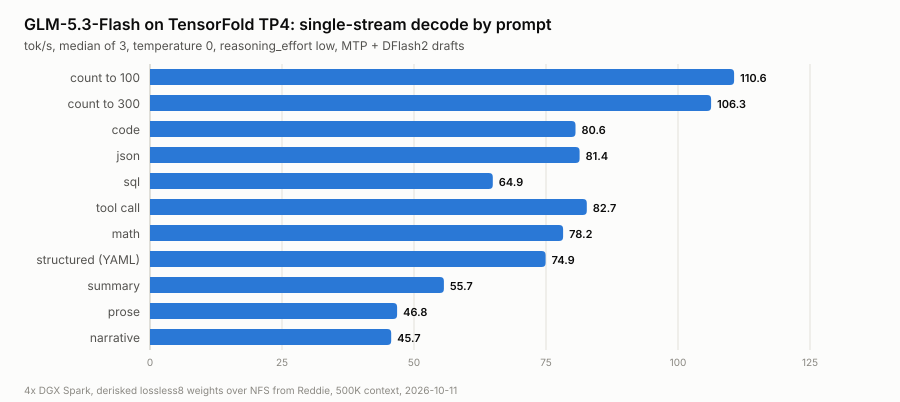
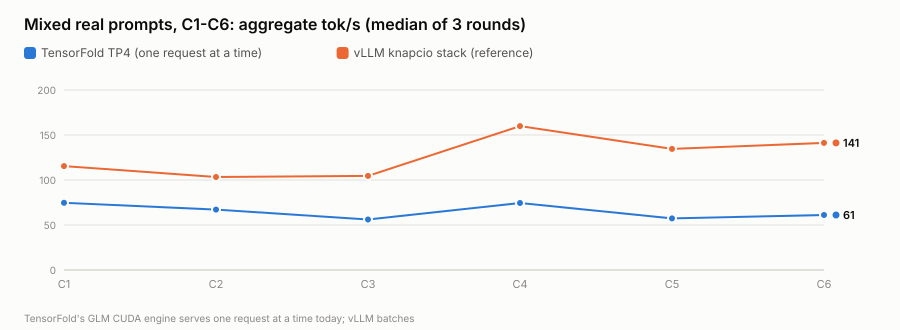
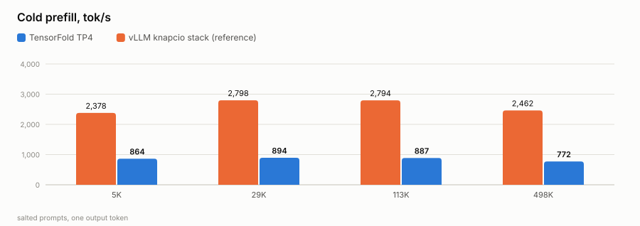

# GLM-5.3-Flash on TensorFold, TP4 on 4× DGX Spark, with our derisked weights

> **Special credit:** [tonyd2wild](https://github.com/tonyd2wild) (the 4× Spark serving recipe this fleet runs) and
> [ashhart/TensorFold](https://github.com/ashhart/TensorFold) (the engine). Full ledger: [CREDITS.md](CREDITS.md).

**Private working repo.** GLM-5.3-Flash served by the TensorFold engine at tensor-parallel 4 across our four DGX
Sparks, from our derisked weights as stored, with Reddie as the head node and the weights read over NFS from Reddie.

## Serving now (2026-10-11)

| | |
|---|---|
| endpoint | `glm-5.3-flash` on `:8000` (Reddie), the fleet's name and port |
| layout | TP4: Reddie rank 0 (HTTP), Spark4 rank 1, Asusi rank 2, Bluey rank 3; NCCL over RoCE |
| weights | `glm-quant-mix-derisked/lossless8` (198 GB) read as stored, over NFS from Reddie |
| formats | routed experts NVFP4, linear-attention projections MXFP8, MLA and shared experts FP8 (128×128 blocks): all on 8-bit / 4-bit kernels as stored |
| context | 500,000 tokens (a 498,635-token prompt measured) |
| vision | on: GLM's vision tower on rank 0 in CUDA |
| thinking | `reasoning_effort: low` by default |
| drafts | MTP and DFlash2 (`incoai/GLM-5.3-Flash-DFlash2`, also over NFS), chosen each round |
| load | about 130 s warm |

Launch, stop, logs: [`deploy/tf_tp4.sh`](deploy/tf_tp4.sh) (`serve | stop | status | logs [rank]`).

## Baseline (2026-10-11)

Speed-night harness ([`bench/bench_tp2_night.py`](bench/bench_tp2_night.py)), temperature 0, `reasoning_effort: low`,
on a private port so fleet traffic could not queue ahead of it. Full tables:
[`runs/2026-10-11-baseline/TABLES.md`](runs/2026-10-11-baseline/TABLES.md); raw JSON in
[`runs/2026-10-11-baseline/results/`](runs/2026-10-11-baseline/results/).

<picture>
  <source media="(prefers-color-scheme: dark)" srcset="runs/2026-10-11-baseline/charts/tf-suite-dark.svg">
  
</picture>

| | TensorFold TP4 | vLLM knapcio stack (reference) |
|---|---|---|
| single stream, count to 100 / code / json / math / prose | 110.6 / 80.6 / 81.4 / 78.2 / 46.8 tok/s | 181.7 / 120.5 / 120.5 / 141.8 / 61.0 |
| time to first token, short prompts | 0.04 to 0.11 s | |
| C1–C6, each prompt type alone | flat: prose about 45, code / math / json about 80, count to 100 about 95, structured about 68 | |
| C1–C6, mixed prompts (peak) | 75 / 77 / 75 / 75 / 76 / 66 | 117 / 153 / 156 / 162 / 176 / 146 |
| cold prefill, 6K / 30K / 114K / 499K tokens | 864 / 894 / 887 / 772 tok/s | 2,378 / 2,798 / 2,794 / 2,462 |
| 500K window | 498,635-token prompt in 646 s | |
| vision | pass (red / blue halves named correctly, 1.5 s) | |

The vLLM column is this fleet's knapcio stack on `nvidia/GLM-5.3-Flash-NVFP4` (2026-09-29, same harness, 500K,
effort low), shown for reference: the derisked weights have the same architecture and formats.

<picture>
  <source media="(prefers-color-scheme: dark)" srcset="runs/2026-10-11-baseline/charts/tf-sweep-vs-vllm-dark.svg">
  
</picture>

<picture>
  <source media="(prefers-color-scheme: dark)" srcset="runs/2026-10-11-baseline/charts/tf-prefill-vs-vllm-dark.svg">
  
</picture>

### What the numbers say

- **One request at a time.** TensorFold's GLM CUDA engine has no batching: requests queue, so C2–C6 aggregate stays
  at the C1 rate and time to first token grows by one reply per queued request (prose C6: p90 75 s). ashhart's
  batched decoder exists for other model families; GLM on CUDA does not have one yet.
- **C1 is 55 to 80 % of vLLM.** A decode step costs 29 ms at TP4: about 14 ms of weight reads, the rest about 90
  small NCCL all-gathers per token over RoCE and many small per-layer kernels. Running the 8-bit layers as stored
  (instead of BF16 at load) made it 4 to 20 % faster than our first boot
  ([`results/tf-tp4-bf16dense-partial.log`](runs/2026-10-11-baseline/results/tf-tp4-bf16dense-partial.log)).
- **Prefill is about a third of vLLM's.**

### What it would take to pass vLLM

1. **Batching** (C2–C6): a multi-stream GLM decoder after ashhart's batched design for other families: per-request
   KDA states and latent caches, attention over mixed requests. The largest piece.
2. **Faster cross-rank sums**: a one-shot RoCE all-reduce in place of the NCCL all-gathers.
3. **Prefill kernels** tuned for TP4 shapes.

## Approach

TensorFold's Python engine (`python-0.6`, Apache-2.0, ashhart) serves GLM-5.3-Flash on CUDA from MLX 4-bit weights
at TP2. From it we:

1. removed every line authored solely by one excluded third-party author, code adapted from their patches, their
   license file and every mention of them (the model families that needed that code went with it);
2. read our ModelOpt checkpoint as stored: NVFP4 routed experts on the engine's grouped NVFP4 kernels, MXFP8 and
   FP8-block projections on its 8-bit kernels, the shared expert in BF16;
3. brought up TP4 across four machines (rank agreement over every rank, scalar scales, index-aware checkpoint scan);
4. added vision on CUDA: GLM's vision tower in torch on rank 0, its feature rows shared with the other ranks and
   written over the image placeholders during prefill.

Everything is in [`engine/`](engine/); each piece's origin is in [PROVENANCE.md](PROVENANCE.md).

## Provenance policy

Code from one excluded third-party author is not used: their commits, code adapted from their patches, their license
file and every mention of them are removed. Commits authored by others are kept as part of the engine. Public facts
and measurements may inform the work; code is written by us or taken from other open-source authors with credit.
Every piece's origin is logged in [PROVENANCE.md](PROVENANCE.md).

## Layout

| path | what |
|---|---|
| `engine/` | the engine: TensorFold Python line (ashhart, Apache-2.0) with our changes |
| `deploy/tf_tp4.sh` | the TP4 launcher (Reddie head, NFS weights, drafts, vision, context, effort, port) |
| `bench/` | the speed-night harness with the per-type C1–C6 sweep and the vision check |
| `runs/2026-10-11-baseline/` | baseline results, tables and charts |

## Fleet facts

| node | rank | role |
|---|---|---|
| Reddie | 0 | head, HTTP `:8000`, NFS server for weights and drafter |
| Spark4 | 1 | follower (weights over NFS) |
| Asusi | 2 | follower (weights over NFS) |
| Bluey | 3 | follower (weights over NFS) |

The previous vLLM GLM deployment is preserved: `~/restore-glm53-flash.sh start` on Reddie (stop TensorFold first).
