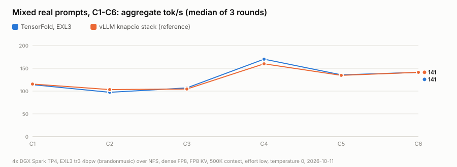
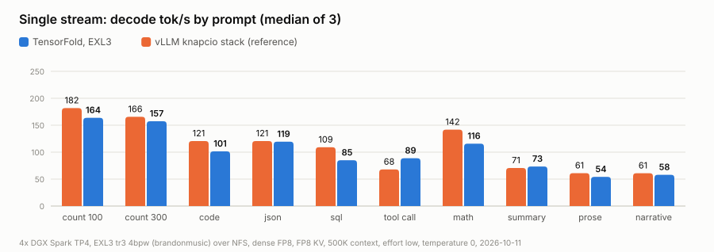
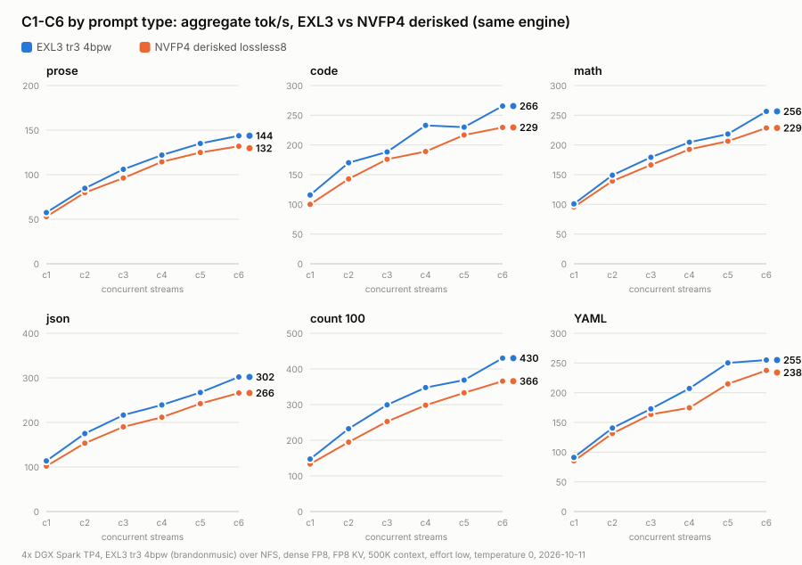
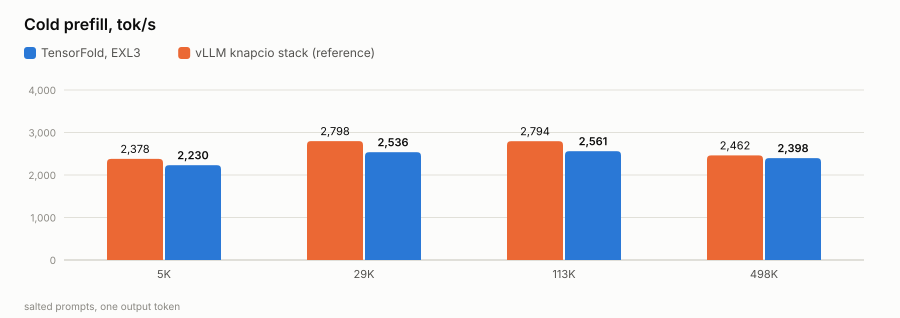

# GLM-5.3-Flash on TensorFold, TP4 on 4× DGX Spark (EXL3)

> **Special credit:** [tonyd2wild](https://github.com/tonyd2wild) (the 4× Spark serving recipe this fleet runs) and
> [ashhart/TensorFold](https://github.com/ashhart/TensorFold) (the engine). Built on
> [MiaAI-Lab](https://github.com/MiaAI-Lab/GLM-5.3-Flash-EXL3-2x-DGX-Sparks-TensorFold)'s GLM patches for TensorFold
> (Apache-2.0) and Brandon M. Music's EXL3 checkpoint. Full ledger: [CREDITS.md](CREDITS.md).

GLM-5.3-Flash served by TensorFold at tensor-parallel 4 across four DGX Sparks: eight requests at once, a 500K window
for each, vision, FP8 KV cache, RoCE all-gathers. Reddie is the head node and serves the weights to the other three
over NFS. Measured against this fleet's vLLM stack on the same harness.

## Serving now (2026-10-11)

| | |
|---|---|
| endpoint | `glm-5.3-flash` on `:8000` (Reddie), the fleet's name and port |
| engine | [`engine-multi/`](engine-multi/): TensorFold v0.6.0 + MiaAI-Lab's GLM patches (Apache-2.0) + our changes |
| weights | [`brandonmusic/GLM-5.3-Flash-tr3-4bpw`](https://huggingface.co/brandonmusic/GLM-5.3-Flash-tr3-4bpw) (164 GiB), over NFS from Reddie |
| formats | routed experts EXL3 4-bit (`mcg` trellis); attention, indexer, shared and dense MLP, head FP8 (`TF_GLM_DENSE=fp8`, a scale per 128 block); `kv_b`, embedding, vision tower BF16 |
| layout | TP4: Reddie rank 0 (HTTP), Spark4 rank 1, Asusi rank 2, Bluey rank 3; RoCE all-gathers on the switch, NCCL for control |
| streams | 8 at once, one shared pool of 5,285,888 tokens, each request up to 500,000 |
| KV cache | FP8 |
| vision | on: GLM's vision tower on rank 0 |
| thinking | `reasoning_effort: low` by default |
| drafts | MTP, DFlash2 (`incoai/GLM-5.3-Flash-DFlash2`) and copy drafts |
| load | about 200 s |

Launch: [`deploy/serve_exl3.sh`](deploy/serve_exl3.sh) (`serve | stop | status | logs [rank]`), a wrapper of
[`deploy/tf_tp4.sh`](deploy/tf_tp4.sh).

## Results (2026-10-11)

Speed-night harness ([`bench/bench_tp2_night.py`](bench/bench_tp2_night.py)), temperature 0, `reasoning_effort: low`,
on a private port so fleet traffic could not take any of the 8 streams; no failures, no preemptions. Full tables:
[`runs/2026-10-11-exl3/TABLES.md`](runs/2026-10-11-exl3/TABLES.md); raw JSON in
[`runs/2026-10-11-exl3/results/`](runs/2026-10-11-exl3/results/).

| | TensorFold, EXL3 | TensorFold, NVFP4 derisked | vLLM knapcio stack |
|---|---|---|---|
| mixed real prompts, C1–C6 (aggregate, median of 3) | 114 / 97 / 107 / 170 / 136 / 141 | 100 / 85 / 101 / 155 / 126 / 134 | 115 / 103 / 105 / 160 / 135 / 141 |
| same, peak of 3 | 119 / 153 / 168 / 170 / 184 / 146 | 103 / 134 / 152 / 156 / 167 / 136 | 117 / 153 / 156 / 162 / 176 / 147 |
| single stream: count to 100 / json / math / code / prose | 164 / 120 / 116 / 101 / 54 tok/s | 150 / 113 / 107 / 109 / 54 | 182 / 121 / 142 / 121 / 61 |
| single stream: summary / tool call (end to end) | 73 / 89 tok/s | 64 / 83 | 71 / 68 |
| code alone, C1 / C2 / C4 / C6 (aggregate) | 116 / 170 / 233 / 266 tok/s | 100 / 143 / 189 / 230 | |
| json alone, C1 / C2 / C4 / C6 (aggregate) | 114 / 175 / 239 / 302 tok/s | 102 / 153 / 212 / 266 | |
| time to first token at C6, short prompts (p90) | 0.4 to 1.0 s | 0.6 to 0.9 s | |
| cold prefill, 6K / 30K / 114K / 499K tokens | 2,230 / 2,536 / 2,561 / 2,398 tok/s | 1,675 / 1,984 / 2,038 / 1,928 | 2,378 / 2,798 / 2,794 / 2,462 |
| 500K window | 498,633-token prompt in 208 s | 259 s | |
| vision | pass (1.6 s) | pass | |
| quality check (10 prompts, 3 languages) | 10 / 10 | | |

The vLLM column is this fleet's knapcio stack on `nvidia/GLM-5.3-Flash-NVFP4` (2026-09-29, same harness, 500K, effort
low), shown for reference.

<picture>
  <source media="(prefers-color-scheme: dark)" srcset="runs/2026-10-11-exl3/charts/tfx-sweep-vs-vllm-dark.svg">
  
</picture>

<picture>
  <source media="(prefers-color-scheme: dark)" srcset="runs/2026-10-11-exl3/charts/tfx-single-vs-vllm-dark.svg">
  
</picture>

<picture>
  <source media="(prefers-color-scheme: dark)" srcset="runs/2026-10-11-exl3/charts/tfx-types-vs-nvfp4-dark.svg">
  
</picture>

<picture>
  <source media="(prefers-color-scheme: dark)" srcset="runs/2026-10-11-exl3/charts/tfx-prefill-vs-vllm-dark.svg">
  
</picture>

### What the numbers say

- **Mixed load is level with vLLM.** Median 94 to 106 % of vLLM at every level, ahead at C3, C4 and C5; the peaks
  are ahead at C1, C3, C4 and C5.
- **Every prompt type scales to six streams** with the first token within about a second (p90): json 114 → 302, code 116 → 266
  aggregate tok/s.
- **One stream is 78 to 99 % of vLLM** on most prompts (json 99 %), ahead on summaries (104 %) and tool calls
  (131 %). Count and math are where vLLM's drafting still leads.
- **Prefill is 91 to 97 % of vLLM**; the 500K prompt reads in 208 s.
- **EXL3 over NVFP4 on the same engine:** a one-row verify step of 21.1 ms instead of 25.1 ms, 5 to 23 % more
  aggregate throughput by prompt type and level (median 11 %), and prefill up 24 to 33 %. ashhart notes the EXL3 path is the optimised one
  in TensorFold; the NVFP4 path is not tuned yet.

### Next

1. **4-bit dense layers** (`TF_GLM_DENSE=q4`, MiaAI-Lab's default): fewer bytes a token for attention and the shared
   experts; measured here next, with the quality check.
2. **Draft policy for count and math**, where vLLM's MTP still leads one stream.

## Earlier builds

| run | engine and weights | |
|---|---|---|
| [`runs/2026-10-11-multi-engine/`](runs/2026-10-11-multi-engine/TABLES.md) | `engine-multi/` on our NVFP4 derisked pack (`glm-quant-mix-derisked/lossless8`) | `NAME=tfmia PROFILE=multi deploy/tf_tp4.sh serve` |
| [`runs/2026-10-11-baseline/`](runs/2026-10-11-baseline/TABLES.md) | [`engine/`](engine/): TensorFold's Python engine (`python-0.6`) with our ModelOpt reader, TP4 and CUDA vision; one request at a time | `deploy/tf_tp4.sh serve` |

## Approach

1. **The engine.** `engine-multi/` is a squashed subtree of TensorFold v0.6.0 with MiaAI-Lab's 106 GLM patches
   (concurrent requests, TP-N, FP8 KV, RoCE all-gathers, split prefill, copy drafts, vision), kept as published with
   their notices.
2. **The checkpoint.** EXL3 is read by TensorFold's GLM EXL3 expert kernels; the BF16 non-expert matrices are held as
   FP8 at load. For the NVFP4 comparison we added a ModelOpt reader and splitter: NVFP4 routed experts on the engine's
   grouped NVFP4 kernels, MXFP8 and FP8-block projections on its 8-bit kernels.
3. **Vision on any GLM template.** Templates that write the media markers themselves (`emit_image` / `emit_video`) get
   each image's mark placed before them.
4. **Four Sparks.** The launcher stops every rank before a start, so no follower joins an old rendezvous; every rank
   reads the weights from the same NFS path.

Each piece's origin is in [PROVENANCE.md](PROVENANCE.md).

## Layout

| path | what |
|---|---|
| `engine-multi/` | the serving engine: TensorFold v0.6.0 + MiaAI-Lab's GLM patches (Apache-2.0) + our changes |
| `engine/` | the first, one-at-a-time build: TensorFold Python line (ashhart, Apache-2.0) with our changes |
| `deploy/` | `serve_exl3.sh` (what serves now) and `tf_tp4.sh`, the TP4 launcher (head node, NFS weights, drafts, vision, context, effort, port, `PROFILE`) |
| `bench/` | the speed-night harness (per-type C1–C6 sweep, vision check) and `qcheck.py`, the quality check |
| `runs/` | each run's tables, raw results and charts |

## Fleet

| node | rank | role |
|---|---|---|
| Reddie | 0 | head, HTTP `:8000`, NFS server for weights and drafter |
| Spark4 | 1 | follower (weights over NFS) |
| Asusi | 2 | follower (weights over NFS) |
| Bluey | 3 | follower (weights over NFS) |
